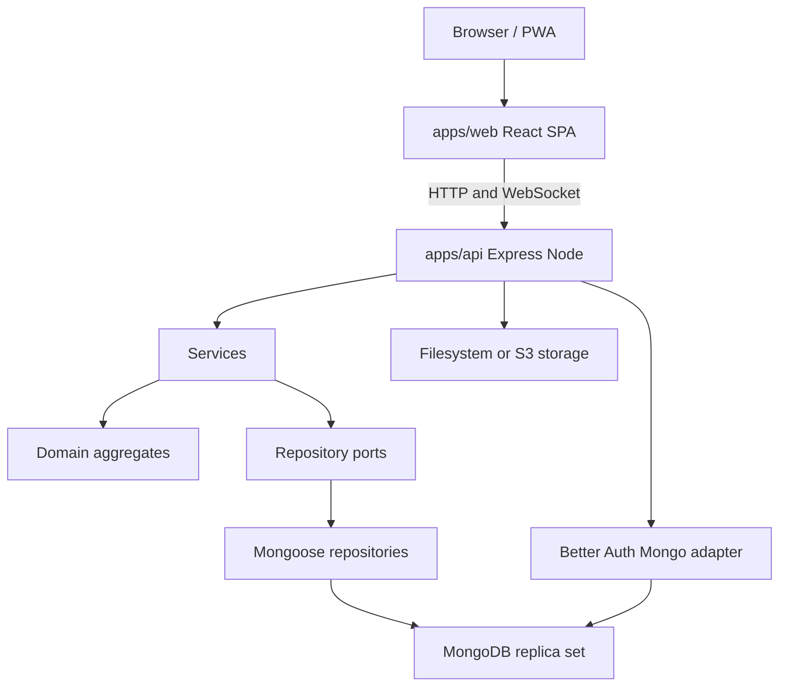

# Architecture

## Topology

## Layers

- **apps/web** — React SPA (FSD). Renders Trips and the Planner, talks to the
  API over `fetch`, and delegates auth to the Better Auth client.
- **apps/api** — Express Node app with isolated legacy Worker reference code (DDD + Hexagonal). `interfaces/http` routes call
  `services` use cases, which operate on `domain` aggregates through
  repository ports implemented in `repositories` and `integrations`.
- **packages/agent-ui-catalog** — framework-neutral json-render catalog,
  prompt, streaming-part compiler, and runtime safety boundary shared by the
  AI adapter and planner renderer. Its Zod 4 dependency is isolated from the
  API's Zod 3 HTTP schemas.

## Request flow

1. The SPA calls `GET /api/trips` (credentials included).
2. Shared HTTP middleware resolves the Better Auth session; unauthenticated requests
   get `401`.
3. The route handler invokes a use case; the use case loads the aggregate via a
   repository port and returns a DTO.
4. The handler serializes the DTO with the shared response envelope.

## Auth flow

- The SPA uses the Better Auth React client against `/api/auth/*`.
- The API mounts `auth.handler` on `/api/auth/*`. Sessions are cookie-based;
  the bearer plugin converts mobile credentials to the same session model;
  business routes read the session through shared middleware.

## Data flow

- Node uses MongoDB/Mongoose and a transaction-capable replica set. Better Auth
  owns its collections through the pinned Mongo adapter.
- New users receive a private Indian sample trip. Mongo schema/index versions
  live in `apps/api/src/config/migrations/`.
- Committed mutations publish through the single-process Node WebSocket server.
  Reconnect forces authoritative refetch; presence and rate limits reset on
  restart. Multiple instances require shared coordination first.

## Deployment and legacy tooling

Native Node deployment on Render is prepared but deferred. The frontend can be
served by Express on the same origin. Uploads need persistent filesystem storage
or S3. See [the Render guide](../../deploy/render/README.md).

Historical Worker entry, Hono transport and SQL composition are isolated under
`apps/api/src/legacy/`. SQL repositories, Prisma snapshots and migration tools
remain available for historical compatibility. They are not imported by the
Node runtime. The Cloudflare deployment workflow is disabled.

See [M6 cleanup](../raahi/M6_MIGRATION_CLEANUP.md) for validation and recovery.
The requested final controllers/routes/db folder layout is a later step.

## Internationalization

The frontend is fully internationalized with `react-i18next` (English +
Chinese). All user-facing copy is centralized in locale resources. See
[../frontend/i18n.md](../frontend/i18n.md).
